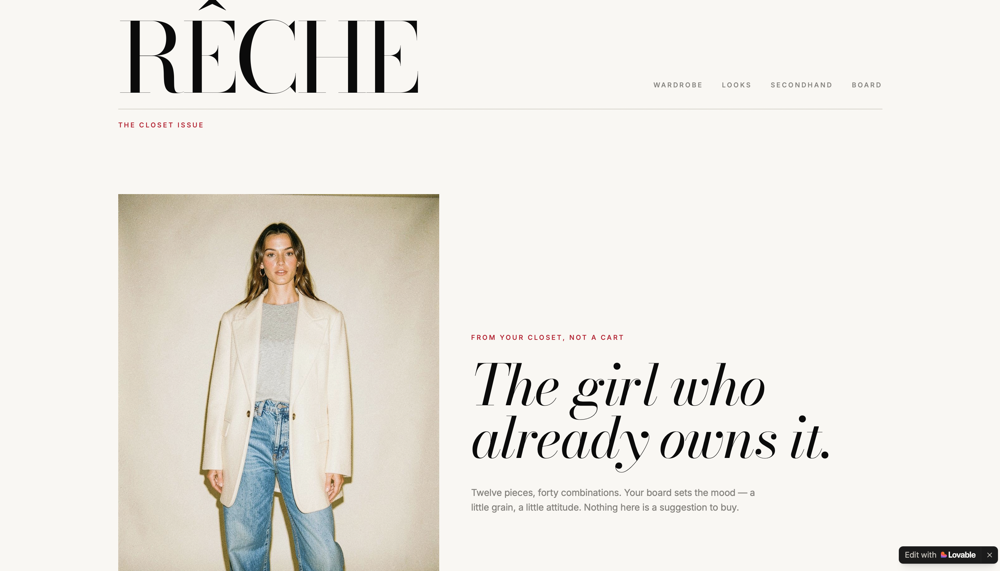
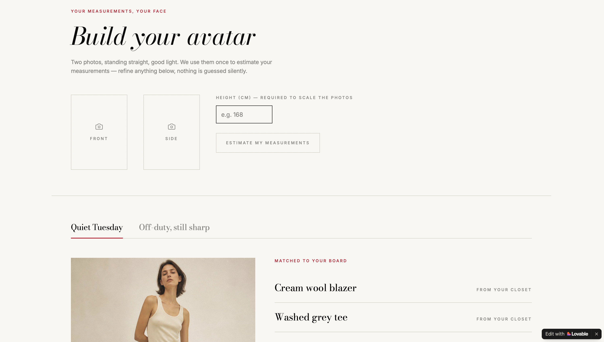
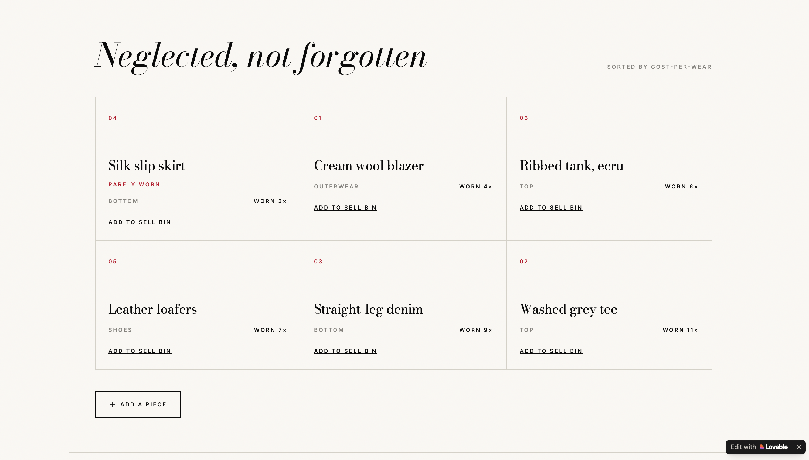

# RÊCHE 👗

**From your closet, not a cart.**

RÊCHE is a wardrobe styling app that helps you get more out of the clothes you already own. You build an avatar from a couple of photos, it puts together looks from your own closet based on your mood board, and it shows you which pieces you actually wear. When something is missing, it points you to secondhand pieces instead of new ones.

| | | |
|:-:|:-:|:-:|
|  |  |  |

## What it does

- **Your avatar** — upload a front and side photo and your height, and the app estimates your measurements, which you can adjust yourself
- **Looks** — outfits put together from your own closet and matched to your mood board, with a try-on view and the option to save a look
- **Cost per wear** — every item shows how many times you've worn it and what it costs per wear, and pieces you never use can go straight to a sell bin
- **Secondhand** — when there's a real gap in your wardrobe, it suggests natural-fibre pieces from Sellpy and Vinted
- **Board** — your mood board, which shapes the looks you get

## Why I built it

Most fashion apps are built to make you buy more. I wanted the opposite: an app that makes your existing wardrobe feel new, and that never suggests buying something new as the answer.

## Built with

Lovable

## Try it

[retro-style-trunk.lovable.app](https://retro-style-trunk.lovable.app)
